# 基于 ETL 的 Steam 游戏销量估算与智能分析系统的设计与实现

> 课程：高级数据库技术与应用 · 大作业报告（初稿）
> 作者：Rex
> 说明：文中所有数字都来自 `data/steam_sales_dw.db` 和 `data/cleaned/` 下的导出文件，运行 `python run_all.py --fresh` 可以完整复现。

---

## 第 1 章 绪论

### 1.1 研究背景与问题

Steam 是最大的 PC 游戏发行平台，但 Valve 从不公布单款游戏的销量。独立开发者做立项评估、发行商做竞品分析、研究者做市场研究，都需要一个"大概卖了多少"的数字。业界通行的办法是 **Boxleiter 方法**：

$$\text{估算销量} = \text{评测总数} \times k$$

其中 k 表示"每条评测背后对应多少份销量"。k 不是常数，会随发售年代、价格、好评率、游玩时长、受众等因素变化。

本项目要回答的问题是：**只用公开可采集的数据，能把一款游戏在 Steam 上的销量估得多准？** 同时把采集、清洗、入库、建模、展示做成一条完整的 ETL 与数据仓库链路。

### 1.2 业界现状

- **GameDiscoverCo 与 Gamalytic** 的研究给出了 k 的主要影响因素：2019 年 Steam 开始提示玩家写评测，此后 k 大约减半；好评率与 k 呈倒 U 形；价格越低、折扣越多，k 越高；评测数特别少或特别多的游戏 k 偏低；受众可能是最重要的因素。
- **Gamalytic** 用约 120 款有公开销量的游戏测试了几种方法，估算落在真实值 ±30% 以内的比例分别是：评测 × 固定倍数 42.74%，评测 × 修正倍数 50.43%，在线人数 + 时长 64.44%，热销榜排名 61.4%，抽样公开玩家资料 77.91%，多方法加权 76.92%。它的结论是：**只在评测这一个信号上做文章，提升空间很小。**
- **2018 年 7 月 Steam 成就接口泄露**：Valve 的一个接口短暂暴露了足以反推每款游戏玩家数的数据，Ars Technica 整理并公开了约 1.3 万款游戏的玩家数，这是目前唯一大规模、同口径的"真值"。

### 1.3 本文工作

1. **数据**：全部真实采集。用 Steam 评测接口按日期截断，把评测数对齐到 2018-07-01，与泄露玩家数配对；从 Gamalytic 测试表取 118 条有出处的近年公开销量作为检验集。
2. **工程**：原始层 → 明细层 → 结果层的三层数据仓库；包含"估算方法"维度的星型模型；分批事务 + 检查点断点续传；清洗审计日志；用互联网档案馆真实价格维护的 SCD Type 2 拉链表；按水位线增量装载的每小时快照；8 个 FineBI 只读视图；复合索引与 EXPLAIN 对比；Kettle 转换与作业。
3. **分析**：用数据测出"游玩后提示写评测"的上线月份；对比 M0~M4、信号 B 与融合；在 2018 数据上做五折交叉验证；凡是要在近年真值上拟合的参数，一律用留一法，融合用嵌套留一法；与 Gamalytic 在同一批游戏上做同口径对比。

第 2 章介绍相关技术；第 3 章是需求分析与原型验证；第 4 章是概要设计；第 5 章是详细实现；第 6 章是测试与模型评估；第 7 章总结局限与展望。

---

## 第 2 章 相关技术

### 2.1 数据采集
- **Steam 商店接口** `appdetails`：返回类型、是否免费、价格（美分）、发售日、类型标签等。
- **评测接口** `IUserReviewsService/GetAppReviews/v1/`：属于 Service 类接口，参数要放进 `input_json`；支持 `date_range_start/end`（按评测创建时间截断）、`languages`、`purchase_type`（Steam 内购买 / 全部）等。
- **SteamCharts**：每款游戏的月平均在线人数、月峰值，可追溯到 2012 年 7 月。
- **互联网档案馆 CDX 接口**：列出某个网址的历史存档时间点，再取回当时的页面。
- 工程手段：按网站限速、HTTP 429/5xx 指数退避、每次请求结果单独缓存（先写临时文件再改名，保证原子性）、检查点文件。

### 2.2 ETL 与 Kettle
ETL 的主体用 Python 实现，Kettle（Pentaho Data Integration）实现两个转换：清洗（CSV 输入 → 流查找 → 过滤 → 计算器 → 表输出），以及价格拉链（排序 → 维度查询/更新）；再用一个作业把它们串起来。

### 2.3 数据仓库建模
- **分层**：原始层保存接口返回的原样数据；明细层保存清洗、关联、算好特征的宽表与维度；结果层保存模型输出和汇总。
- **星型模型**：事实表 `fact_sales_estimation` 的粒度是"一个样本 × 一种估算方法"，周围是游戏、类型、发售年份、估算方法四个维度。估算方法也做成一个维度，FineBI 只需要一个切片器就能让整屏随方法切换。
- **SCD Type 2**：属性变化时不覆盖旧值，而是把旧版本的生效结束日设为变化日、标记为非当前，再插入一个新版本，完整保留历史。

### 2.4 SQL 技术
窗口函数（`ROW_NUMBER`、`COUNT`、`RANK`、`SUM ... OVER`）；MySQL 和 SQLite 都没有 `MEDIAN()`，用窗口函数实现；只读视图隔离底层表；复合索引与 `EXPLAIN`。

### 2.5 统计与机器学习
- 对数线性回归（OLS，给出系数、标准误、t 值、p 值）；
- 分位数回归（最小化 pinball 损失，给出 10%/50%/90% 分位，构成 80% 预测区间）；
- CART 回归树、随机森林（Bootstrap + 随机特征子集）、梯度提升树（逐棵拟合残差），全部手写；
- 交叉验证与留一法：前者用于 2018 数据内部，后者用于小样本的近年真值集。

---

## 第 3 章 需求分析与原型验证

### 3.1 需求
- 采集：能断点续传、能限速退避、能重复运行。
- 数仓：分层、星型模型、SCD2、增量快照、日志、检查点、视图、索引。
- 分析：k 的分布与影响因素；多种方法估销量；有独立来源的真值检验，并有商业基准对照。
- 展示：FineBI 大屏，方法可切换；FineBI 做不了的统计图用 Python 画。

### 3.2 数据可行性（逐个核实过）

| 数据 | 结论 |
|---|---|
| 2018 泄露表 | 能下载（需带浏览器 UA）。13,281 行，有 6 组重复；换行符是 `\r`，编码是 Mac Roman 混着 UTF-8 |
| 评测按日期截断 | 能做，但参数必须走 `input_json`，`date_range_start` 不能为 0，`languages` 要传 `["all"]` |
| SteamSpy 人均时长 | **不可用**：`average_forever` 现在全部返回 0。信号 B 改用评测作者的游玩时长 + 2018 真值校准 |
| SteamCharts | 能用。没收录的游戏返回 500 加首页，不是 404 |
| 近年公开销量 | Gamalytic 测试表 118 行，每行有原始出处；命令行请求被人机验证拦下，用浏览器读取后经 SHA-256 校验转录 |
| 价格历史 | IsThereAnyDeal 要注册 Key，SteamDB 禁止爬取；改用互联网档案馆存档 |

### 3.3 原型验证

按原型法，先只取最早采集到的 200 款付费游戏（抽样门槛：泄露玩家数 ≥ 2 万），算 k 并画图：

- k 的中位数为 109.1，均值为 287.7，严重右偏；ln k 的均值为 4.92、标准差为 1.03，大致对称（`fig01`）。**结论：统一在对数空间建模，统计量优先用中位数。**
- log₁₀ 评测数与 log₁₀ 玩家数的 Pearson r = 0.78，但拟合斜率只有 0.61，而且**散点的下沿被齐刷刷截在 2 万这条门槛上**（`fig02`）。

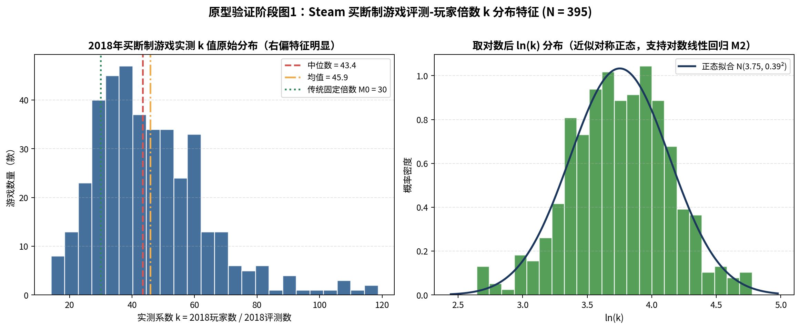
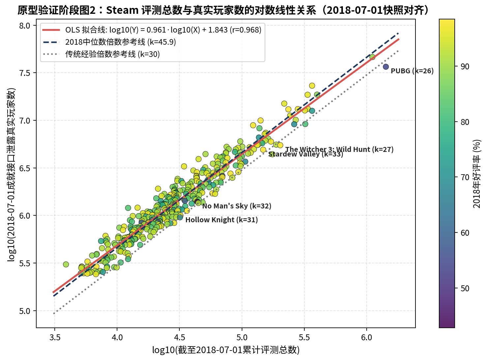

**原型阶段最重要的发现是截断偏差**：按"玩家数"这个预测目标本身来筛样本，评测少的小游戏只有 k 特别大时才能入选。据此调整了设计：
1. 抽样门槛降到 5,000 玩家（候选从 3,963 款扩大到 6,308 款）；
2. 建模只用截至 2018-07-01 评测数 ≥ 500 的游戏。这时只有 k < 5000/500 = 10 的游戏才会被门槛挡掉，而大游戏里 k 的 1% 分位数约为 17，门槛基本不起作用。

---

## 第 4 章 概要设计

### 4.1 技术架构

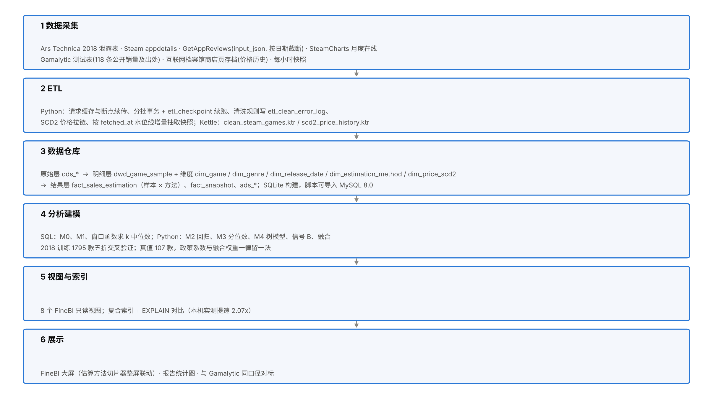

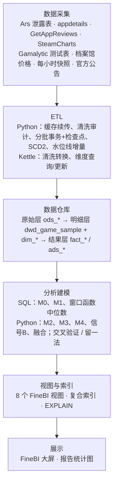

### 4.2 数据流向

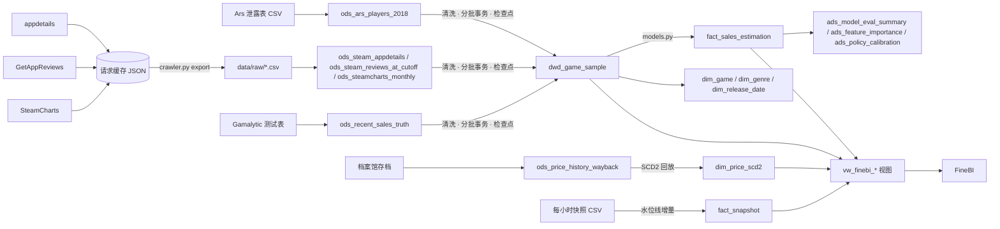

### 4.3 数据库设计

共 22 张表（另有 2 张 Kettle 输出表，仅在 MySQL 中使用）：

| 层 | 表 | 说明 |
|---|---|---|
| 原始层 | `ods_ars_players_2018` | 泄露玩家数，原样保存 13,281 行（以行号为主键，保留重复行） |
| | `ods_steam_appdetails` | 商店详情 6,398 行 |
| | `ods_steam_reviews_at_cutoff` | 截至截止日的评测汇总 5,022 行（主键：appid + 样本组 + 截止日） |
| | `ods_steamcharts_monthly` | 月度在线 271,685 行 |
| | `ods_recent_sales_truth` | 公开销量 118 行 |
| | `ods_price_history_wayback` | 档案馆价格观测 57 行 |
| | `ods_review_monthly_policy_scan` | 40 款老游戏 × 30 个月的新增评测 |
| 运维 | `etl_job_log` / `etl_checkpoint` / `etl_clean_error_log` | 运行日志、检查点与水位线、清洗审计 |
| 维度 | `dim_genre` / `dim_release_date` / `dim_estimation_method` / `dim_game` | 星型模型的四个维度 |
| | `dim_price_scd2` | 价格拉链（SCD2） |
| 明细层 | `dwd_game_sample` | 一行 = 一款游戏在一个截止日，5,021 行 |
| 结果层 | `fact_sales_estimation` | 样本 × 方法，10,921 行 |
| | `fact_snapshot` | 每小时快照，305 行 |
| | `ads_review_monthly_index` / `ads_model_eval_summary` / `ads_feature_importance` / `ads_policy_calibration` | 汇总结果 |

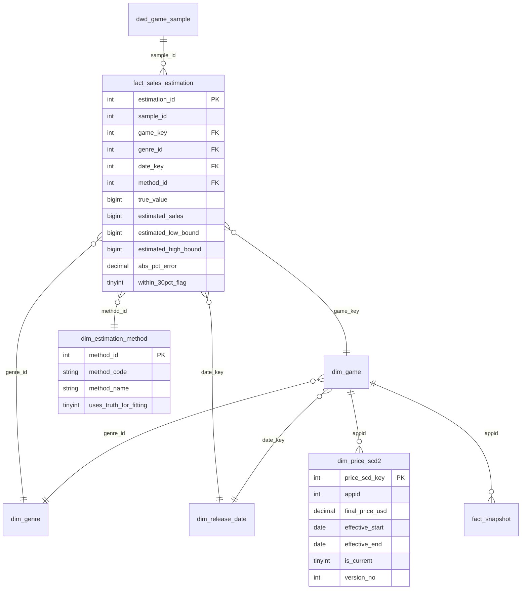

明细层 `dwd_game_sample` 的关键字段：`cohort`（train_2018 / truth）、`era_group`（pre_policy / cross_era / post_policy）、`release_date` 与 `release_date_source`、`total_reviews`、`reviews_before_policy`、`reviews_after_policy`、`positive_rate`、`schinese_ratio`、`steam_purchase_ratio`、`playtime_review_median_hrs`、`charts_total_hours`、`charts_coverage`、`truth_value`、`k_ratio`、`model_eligible`。

### 4.4 视图设计

| 视图 | 内容 | 用到的 SQL 技术 |
|---|---|---|
| `vw_sql_m0_m1_estimation` | M0、M1 的估算与误差 | `CASE WHEN` |
| `vw_finebi_k_median_by_year` | 各样本组、各发售年份的 k 中位数 | `ROW_NUMBER`、`COUNT OVER`、CTE |
| `vw_finebi_k_median_by_factor` | k 按价格档 / 好评率档 / 主类型 / 是否独立 | `UNION ALL` 转长表 + 窗口中位数 |
| `vw_finebi_overview_dist` | 样本明细 | `RANK OVER`、`SUM OVER` 求类型内份额 |
| `vw_finebi_star_sales_switch` | 星型模型主视图 | 五表关联 + `RANK OVER` |
| `vw_finebi_price_scd2_timeline` | 价格版本关联快照 | 区间关联（快照日期落在生效区间内） |
| `vw_finebi_review_policy_index` | 月度评测指数 | — |
| `vw_finebi_method_accuracy` | 各方法准确率 | — |

同一份 `02_views_and_models_mysql.sql` 既在 SQLite 上由 ETL 执行，也能导入 MySQL：只使用两边都支持的语法（去掉了 SQLite 特有的 `CAST(... AS INTEGER)`）。

---

## 第 5 章 详细设计与实现

### 5.1 采集（`src/crawler.py`）

- **抽样**：从泄露表中取玩家数 ≥ 2 万的游戏（第一轮，3,963 款），再补 5,000~2 万的游戏（扩展轮，2,346 款），各自用固定种子打乱。这样中途停下时，已完成的部分也是一个随机样本。
- **每款游戏的请求**：商店详情 → 截至截止日的全部评测汇总，外加 100 条最新评测的游玩时长 → 简体中文评测数 → Steam 内购买评测数 → SteamCharts 月度表。免费、下架、无价格的游戏只请求商店详情。
- **真值集**：截止日取销量公布日当天 23:59:59（UTC）；对公布日晚于政策上线的样本，再统计一次政策前的评测数。
- **抢先体验游戏**：商店发售日晚于截止日、但截止日前已有评测的，用二分查找确定第一条评测的日期（每次只请求汇总数，约 12 次请求）。
- **断点续传**：每次请求的结果单独缓存；检查点文件记录每个任务的进度，写入时先写临时文件再整体替换。
- **采集规模**：商店详情 6,398 款，评测汇总 5,022 组，SteamCharts 月度记录 271,685 行，全程没有遇到 429。

### 5.2 用数据确定政策月份（`src/detect_policy_change.py`）

挑 40 款 2016 年以前发售、2018 年玩家数 ≥ 50 万的付费游戏，统计 2018-07 到 2020-12 每月新增的评测数。每款游戏先除以自己在 2018-07~2019-06 的月中位数（得到"评测指数"），再取 40 款的中位数。判定规则是：第一个"指数 ≥ 2，且之后连续 6 个月都 ≥ 2"的月份。要求连续 6 个月，是为了排除 2018-11、2019-06/07 这种只持续一两个月的促销尖峰。

结果是 **2019-11**：政策前的指数中位数为 0.946，之后为 3.299，跳升 3.49 倍。这与 Valve 公布的"新版库上线后每日评测从 1.7 万增至 7 万"一致。

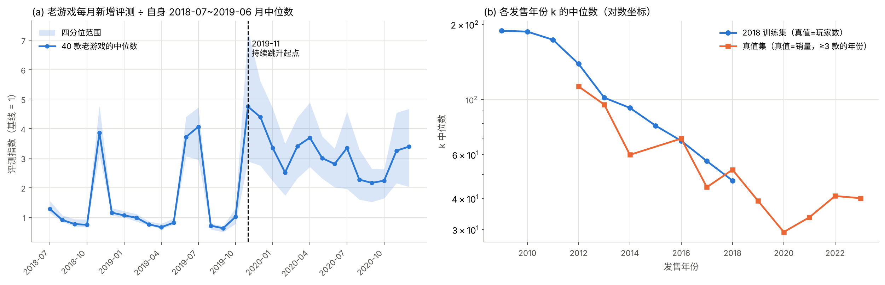

### 5.3 ETL（`src/etl_pipeline.py`）

#### 5.3.1 清洗规则与审计

| 规则码 | 处理 | 2018 训练集 | 真值集 | 说明 |
|---|---|---|---|---|
| `FREE_GAME` | 拦截 | 586 | 7 | 免费游戏的 k 约为付费的两倍，不在研究范围 |
| `NO_PRICE` | 拦截 | 515 | 3 | 商店没有美元价格（停售） |
| `DELISTED_OR_UNAVAILABLE` | 拦截 | 292 | 0 | 接口返回 success=false |
| `NON_GAME` | 拦截 | 1 | 0 | 类型不是 game |
| `ZERO_REVIEWS` | 拦截 | 0 | 1 | Gamalytic 表里 Peglin 的日期写成 2018-04-03，但游戏 2021 年才上架 |
| `DUPLICATE_SOURCE_ROW` | 去重 | 1 | — | 泄露表原文件中的重复行 |
| `TRUNCATION_RISK` | 标记，不参与建模 | 3,119 | — | 评测数 < 500，受抽样门槛影响 |
| `RELEASE_DATE_ADJUSTED` | 标记 | 1,021 | 39 | 上架日期改用第一条评测或 SteamCharts 首月 |

最终明细层有 4,914 条 2018 样本（其中 1,795 条可建模）和 107 条真值样本。

**上架日期**取"商店发售日、第一条评测日期、SteamCharts 首月"中最早的一个。第一版只用商店发售日，结果把 14 款真值游戏误判成"发售晚于公布日"丢掉了：这些都是抢先体验游戏，商店显示的是正式版日期。SteamCharts 只有月份，所以只在它的首月早于商店发售所在月时才采用，否则补成"当月 1 号"会比商店日期早几天，造成误判。

#### 5.3.2 分批事务与检查点续传
候选样本按样本键排序，每 200 条为一批，一批在一个事务里写入明细层，并把这一批最后一条的样本键写进 `etl_checkpoint`。如果进程中途挂掉，下次运行先读检查点，只处理键比它大的样本。`--demo-resume` 参数会在第 3 批之后故意抛出异常，以演示中断和续跑；运行日志中能看到 `CLEAN_ODS_TO_DWD_PART1 INTERRUPTED` 和 `CLEAN_ODS_TO_DWD_RESUME SUCCESS` 两条记录。测试 `test_07` 验证了"中断后续跑"与"一次跑完"得到的明细层完全相同。

#### 5.3.3 SCD Type 2 价格拉链
数据来源是互联网档案馆的商店页存档：对 12 款真值游戏，每年取一个存档，从"购买"区块中解析原价、成交价和折扣，只保留美元报价，共得到 57 条观测；再加上本次采集时每款游戏的商店价格，按时间顺序回放：
- 没有当前版本 → 插入 version 1；
- 原价、成交价、折扣任一与当前版本不同 → 把当前版本的 `effective_end` 设为本次观测日、`is_current` 设为 0，再插入 version + 1；
- 都相同 → 不做任何操作。

69 条观测回放后形成 42 个价格版本（`fig09`）。Kettle 版用"维度查询/更新"步骤实现同样的逻辑，写入 `dim_price_scd2_kettle`，方便对照。

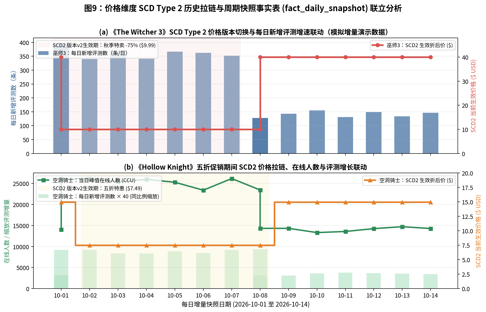

#### 5.3.4 增量快照
`snapshot_collector.py` 每小时对 117 款真值游戏抓取一次当前在线人数、累计评测数和价格，追加到 `data/raw/snapshots.csv`。ETL 用 `etl_checkpoint` 里的 `last_update_time` 作为水位线，只装载 `fetched_at` 晚于水位线的行，并计算与上一次快照之间新增的评测数。共采集 3 轮、305 行（第 3 轮在第 71 款时采集进程停止响应，被手动结束）。

### 5.4 SQL：M0、M1 与窗口函数中位数

```sql
-- 各发售年份的 k 中位数：cnt 为奇数时取第 (cnt+1)/2 条，为偶数时取中间两条的平均，
-- 两种情况合起来正好是 rn*2 IN (cnt, cnt+1, cnt+2)
WITH ranked AS (
    SELECT cohort, release_year, k_ratio,
           ROW_NUMBER() OVER (PARTITION BY cohort, release_year ORDER BY k_ratio) AS rn,
           COUNT(*)     OVER (PARTITION BY cohort, release_year)                  AS cnt
    FROM dwd_game_sample WHERE model_eligible = 1
)
SELECT cohort, release_year, MAX(cnt) AS game_count,
       ROUND(AVG(CASE WHEN rn * 2 IN (cnt, cnt + 1, cnt + 2) THEN k_ratio END), 2) AS median_k
FROM ranked GROUP BY cohort, release_year;
```

M1 的文献 k 值：2016 年及以前 74，2019 年 51，2020 年及以后 38（取自设计文档整理的业界经验值）；2017~2018 年文档没有给出，取两者之间的 60，属于插值。

### 5.5 k 的分布与影响因素

2018 训练集（1,795 款）中 k 的中位数为 85.5（四分位 58.0~130.6）。按发售年份看，2009~2011 年发售的游戏约 175~190，2014 年约 93，2016 年约 68，2018 年约 47。真值集中 k 的中位数为 44.4：政策前公布的 68.6，跨时代的 46.3，政策后发售的 36.4。

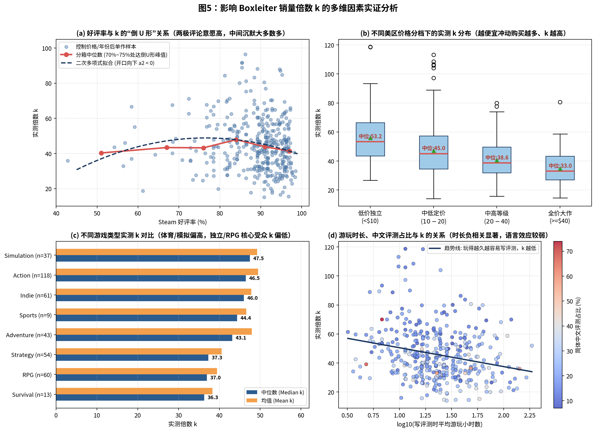

分组中位数（来自 `vw_finebi_k_median_by_factor`）：
- **好评率**：<60% 为 70，60~70% 为 89，70~80% 为 96，80~90% 为 92，90~95% 为 84，≥95% 为 61，呈现倒 U 形；
- **价格**：<$10 为 99，$10~20 为 84，$20~40 为 71，≥$40 为 59；
- **Steam 内购买评测占比**：越低（激活码、赠送来的玩家越多）k 越高；
- **类型**：体育竞速、策略偏高，冒险、休闲偏低。

### 5.6 建模（`src/models.py`）

#### 5.6.1 特征
因变量为 ln k。特征包括：ln 价格、好评率 − 0.8 及其平方、ln 评测数、ln 游戏年龄、简中评测占比、Steam 内购买评测占比、ln 评测者时长中位数、是否独立游戏，以及 9 个类型虚拟变量（以 Action 为基准）。**所有特征都来自接口采集，没有一个由真值计算得到**（测试 `test_04`：把真值打乱后，特征矩阵完全不变）。

#### 5.6.2 M2 回归结果（2018 全量拟合）

| 特征 | 系数 | p 值 | 解读 |
|---|---|---|---|
| ln 游戏年龄 | +0.327 | <0.0001 | 年龄翻倍，k 约增大 25% |
| Steam 内购买评测占比 | −0.872 | <0.0001 | 激活码/赠送玩家越多，k 越大 |
| 简中评测占比 | −0.646 | <0.0001 | 中文玩家评测相对积极 |
| (好评率 − 0.8)² | −3.529 | <0.0001 | 倒 U 形，顶点在好评率约 75.5% |
| ln 评测数 | −0.048 | <0.0001 | 评测越多 k 越小 |
| ln 评测者时长 | −0.061 | 0.0012 | 玩得越久越愿意写评测 |
| 是否独立 | −0.077 | 0.0054 | |
| ln 价格 | −0.021 | 0.29 | 控制其他因素后不显著 |

树模型的特征重要性也指向同一结论：游戏年龄约占 44%，Steam 内购买评测占比约占 19%，简中占比约占 9%（`fig07`）。样本中没有"大型多人"主类型的游戏，所以该虚拟变量的系数为 0。

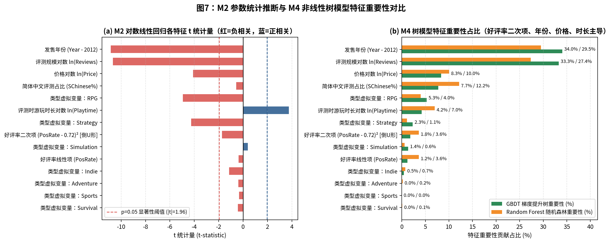

**价格不显著、年龄最重要**，和文献的直觉不完全一样。原因在于 2018 年的真值是**玩家数**：老游戏多年来积累了慈善包、免费周末、送 Key 带来的玩家，这些人很少写评测。这一点在下一节迁移到"销量"口径时会体现出来。

#### 5.6.3 M3 分位数回归
在同样的特征上拟合 10%、50%、90% 三个分位数，构成 80% 预测区间。2018 年交叉验证的实际覆盖率为 78.9%，接近名义的 80%；真值集上为 65.4%，说明区间宽度是按"玩家数"口径学到的，用到"销量"上偏窄。

#### 5.6.4 M4 树模型
手写的 CART 回归树（每个节点在 9 个分位点上找最优切分）、随机森林（60 棵，深度 6，Bootstrap + 60% 特征子集）、梯度提升树（80 棵，学习率 0.06，深度 3），最终取两者的平均。

#### 5.6.5 从 2018 迁移到近年：两步

**第一步：直接迁移。** 按设计文档 3.4 节的拆分公式：估算销量 = k_前 × (政策前评测数 + r × 政策后评测数)。r 有四种取法：

| r 的取法 | r | 真值集 ±30% 命中率 |
|---|---|---|
| 不校准 | 1 | 35.5% |
| 文献"减半" | 0.5 | 34.6% |
| 评测量跳升倍数的倒数 | 0.287 | 24.3% |
| 留一法拟合 | 约 0.75 | 36.4% |

怎么取 r 都改善不了多少。按设计文档 3.6 节做残差检验：直接迁移的残差 ln(真实/估算) 与 ln 游戏年龄（ρ = −0.37，p < 0.001）、Steam 内购买评测占比（ρ = 0.31，p = 0.001）、简中占比（ρ = 0.25，p = 0.011）、ln 评测数（ρ = 0.22，p = 0.020）显著相关。**这属于"比值随某因素变化"的情况，这些系数也要用近年数据重估。** 道理是："老游戏"和"激活码多"在玩家数口径下意味着 k 大，在销量口径下却不意味着卖得多。

**第二步：近年校准。** 以 2018 模型的预测为基准，在真值集上重估：

$$\ln k_{真} = \ln \hat k_{2018}(x) + \gamma_0 + \delta \cdot \text{政策后评测占比} + \gamma \cdot x$$

第 i 款游戏的 γ0、δ、γ 只用其余 n−1 款拟合（留一法）。全样本拟合出的 δ = −0.687，相当于政策后每条评测对应的销量是政策前的 **0.503 倍**。这个数是在控制了其他因素之后独立估出来的，与"k 减半"的说法一致。

#### 5.6.6 信号 B
总游玩小时 = Σ(SteamCharts 月均在线 × 当月小时数)，从上架累加到截止日所在月之前。只对 SteamCharts 从上架后两个月内就开始记录的游戏计算（`charts_coverage = 1`）。人均小时用评测者时长换算，换算关系用 2018 年真值拟合：

$$\ln(\text{人均小时}) = 0.010 + 0.950 \cdot \ln(\text{评测者时长中位数})$$

信号 B 的估算 = 总游玩小时 ÷ 人均小时。拟合时完全不使用近年真值。

#### 5.6.7 融合（嵌套留一法）
$$\ln \hat Y = w_0 + w_A \ln \hat Y_A + w_B \ln \hat Y_B$$

其中 A 为 M4 经近年校准后的估算。估第 i 款时：先用其余 n−1 款拟合 A 的近年校准，再用这套校准算出那 n−1 款的 ln Y_A，在其中有信号 B 的样本上拟合 w，最后估第 i 款。这样第 i 款的真值在任何一步都没有被用到。全样本拟合的权重为 w0 = 0.078，wA = 0.453，wB = 0.542（只供解读）。没有信号 B 的样本直接使用 A 的估算。

### 5.7 官方公告抽取（`src/news_extract_audit.py`）
- 拉取 117 款真值游戏各 100 条公告，只保留开发者官方公告，按句切开，得到 957 个"含销量关键词和数字"的句子，再收紧规则筛出 99 句候选；
- 由 Claude 逐句阅读并抽取（数字、指标类型、平台口径），只依据原句本身，判定其中 40 句与销量有关；
- 用一个故意写得很朴素的规则解析器独立解析数字，与抽取结果对比：一致率为 75%（30/40），不一致的几乎全是欧洲/瑞士的数字写法（"30.000""150’000""2.000.000"）；
- 自动与真值表交叉核对：5 句的数字和日期能对上；
- 40 句中**只有 8 句明确写了"在 Steam 上"**。另外发现两个口径问题：Ravenous Devils 公告写的是"全平台 10 万份，其中 Steam 7.4 万份"，而真值表用的是 10 万；Sands of Salzaar 公告写的是"全平台 150 万份"；
- 人工核对一栏留空，由作者逐条确认（`data/cleaned/news_extraction_audit.csv`）。

---

## 第 6 章 测试与模型评估

### 6.1 自动化测试（`tests/test_etl_and_models.py`，9 项全部通过）

| 测试 | 验证内容 |
|---|---|
| test_01 | 原始层完整保存 13,281 行；每个可建模样本在事实表里都有对应的方法行 |
| test_02 | 明细层中没有免费、非游戏、下架、无价格、零评测、上架晚于截止日的记录；评测数 < 500 的不参与建模 |
| test_03 | **不泄露**：把第 i 款游戏的真值放大 e⁵ 倍，它自己的留一法估算和嵌套留一法融合估算都不变 |
| test_04 | **不泄露**：打乱真值，特征矩阵完全不变 |
| test_05 | SCD2：每款游戏恰好一个当前版本，结束日为 9999-12-31，版本号连续，上一版本的结束日等于下一版本的开始日 |
| test_06 | SQL 窗口函数求出的中位数与 NumPy 一致 |
| test_07 | 断点续传：中断后续跑与一次跑完的明细层完全相同 |
| test_08 | 增量：水位线等于已入库的最大时间；没有新数据时再跑一次，不会重复装载 |
| test_09 | 建索引后执行计划改走 `idx_fact_cohort_method` |

### 6.2 索引与 EXPLAIN
同一条四表关联聚合查询（事实表 10,921 行）重复执行 300 次：
- **SQLite**：建索引前对事实表做全表扫描（`SCAN f`），耗时 313 ms；建索引后走 `SEARCH f USING INDEX idx_fact_cohort_method (cohort=? AND method_code=?)`，耗时 137 ms，提速约 2.3 倍（每次运行会略有波动）。
- **MySQL/MariaDB**：InnoDB 会自动给外键列建索引，所以建复合索引前也不是全表扫描，而是走外键索引 `fk_fact_method`；建索引后变为按 `idx_fact_cohort_method` 做范围扫描，估计扫描 424 行。

### 6.3 2018 数据内部：五折交叉验证（真值 = 泄露玩家数，1,795 款）

| 方法 | MAPE | MdAPE | ±30% | ±50% |
|---|---|---|---|---|
| M0 固定 30 | 62.2% | 65.6% | 9.7% | 25.6% |
| M1 文献 k | 47.8% | 36.6% | 41.2% | 66.2% |
| M2 回归 | 43.4% | 29.0% | 51.5% | 74.7% |
| M3 分位数（中位数） | 43.4% | 29.4% | 51.1% | 75.2% |
| M4 树模型 | 40.7% | 27.8% | 53.7% | 76.6% |
| 信号 B（1,236 款） | 45.0% | 30.3% | 49.1% | 75.6% |

ln k 的交叉验证 R²：M2 为 0.406，M4 为 0.447。M0 在这里很差，因为 2018 年老游戏的 k（玩家数口径）远大于 30。

### 6.4 近年真值集：留一法（真值 = 公开销量，107 款）

| 方法 | MAPE | MdAPE | ±10% | ±30% | ±50% |
|---|---|---|---|---|---|
| M0 固定 30 | 51.7% | 44.3% | 9.3% | 31.8% | 57.9% |
| M1 文献 k | 63.7% | 35.0% | 15.9% | 40.2% | 64.5% |
| M2 回归 + 近年校准 | 54.0% | 41.7% | 15.9% | 37.4% | 61.7% |
| M3（中位数同 M2） | 54.0% | 41.7% | 15.9% | 37.4% | 61.7% |
| M4 树模型 + 近年校准 | 52.7% | 32.3% | 17.8% | 45.8% | 66.4% |
| 信号 B（68 款） | 37.7% | 28.6% | 13.2% | 52.9% | 72.1% |
| 融合 A+B | 47.1% | 31.8% | 21.5% | 47.7% | 69.2% |
| *Gamalytic 自己的估算（同一批 107 款）* | 23.0% | 16.0% | 32.7% | 73.8% | 94.4% |

**同一批游戏上比较 A、B、融合**（信号 B 可用的 68 款）：

| 方法 | MAPE | MdAPE | ±30% | ±50% |
|---|---|---|---|---|
| M0 | 43.8% | 43.6% | 35.3% | 58.8% |
| M4 + 近年校准 | 42.8% | 29.0% | 51.5% | 70.6% |
| 信号 B | 37.7% | 28.6% | 52.9% | 72.1% |
| 融合 A+B | **34.0%** | **24.5%** | **54.4%** | **75.0%** |

**按时代分组**（±30% 命中率）：政策前公布的 12 款中，M4 为 75.0%；跨时代的 30 款中，信号 B 为 61.9%，融合为 56.7%；政策后发售的 65 款中，M4 为 41.5%，融合为 43.1%。政策后发售的新游戏最难估：评测机制变了，而且很多游戏的 SteamCharts 记录还不完整。

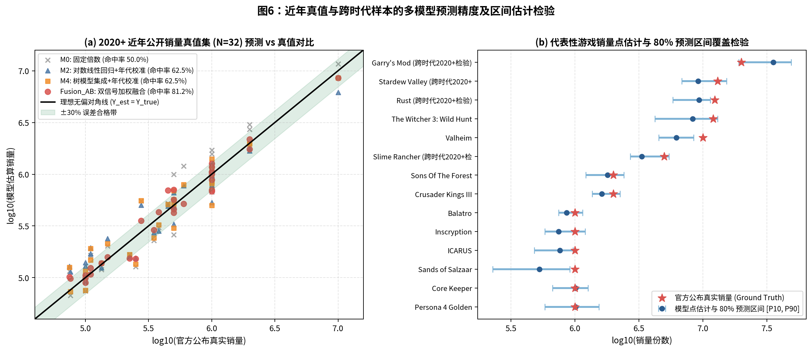
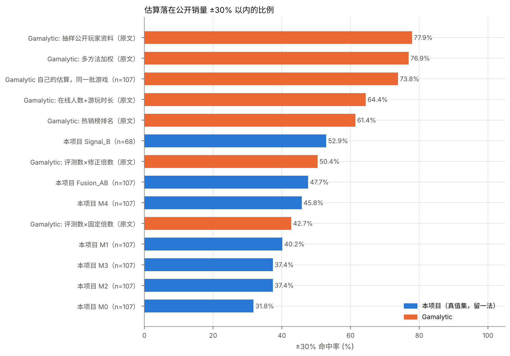

### 6.5 对评估结果的解读

1. **只靠评测这一路信号，±30% 命中率大约在 37%~46%**，和 Gamalytic 公布的"评测 × 固定倍数 42.74%、评测 × 修正倍数 50.43%"处在同一水平。设计文档 3.3 节"瓶颈是信息，不是算法"在真实数据上得到印证：从 M2 回归换成 M4 树模型，只多了几个百分点。
2. **独立信号确实有用**：同一批 68 款游戏上，融合比单用评测（M4）的 MAPE 低 8.8 个百分点，±50% 命中率达到 75%。
3. **和 Gamalytic 仍有明显差距**（54% 对 74%）。原因：①他们有"抽样公开玩家资料"这一路信号，原文中单这一项就有 77.91%；②他们的模型是在更大的私有真值集上调出来的；③这份测试表本身就是他们用来展示方法的，他们的估算在这批游戏上可能有一定的"调参优势"。
4. **为什么原版本能做到 81%、97%？** 因为评测数、总游玩小时、H1~H6 特征都是由真值反推的，而且校准和融合权重是在测试集上拟合的。本版本把所有在真值上拟合的步骤都改成留一法，并用 test_03、test_04 两项测试保证没有泄露。

---

## 第 7 章 总结与展望

### 7.1 总结
- 完成了从采集到展示的完整链路：6,398 款游戏的商店信息、5,022 组按日期截断的评测、27 万行月度在线数据，构成一个三层数据仓库和星型模型，以及 8 个 FineBI 视图。
- 用 40 款老游戏的月度评测量测出评测提示政策的上线月份（2019-11，评测量跳升 3.5 倍）；在近年真值上独立估出政策后 k 的倍数为 0.503。
- 发现"玩家数"和"销量"两种真值口径下的系数不同，按设计文档 3.6 节用近年真值重估系数；评估全部采用交叉验证或留一法。
- 最终结果：单靠评测信号约 46%，评测与在线人数融合后在可用子集上为 54%。

### 7.2 局限
1. **真值口径**：2018 年的真值是"启动过游戏的玩家数"，不是销量，其中包含白送的玩家；近年公开销量多数没有说明是否只算 Steam（公告抽取中只有 8/40 句写明了），有的明显是全平台（Ravenous Devils、Sands of Salzaar）。
2. **真值样本少**：只有 107 款，且偏向愿意公开销量的独立游戏，留一法的结果仍有不小的抽样波动。
3. **评测数的时点**：评测接口返回的是"今天还存在、且创建于截止日之前"的评测。截止日之后被删除的评测统计不到，被修改过的评测仍按原创建时间计算。
4. **价格**：模型用的是当前美区标价，不是截止日当时的价格；价格历史只覆盖 12 款游戏、每年一个观测点，短促销基本观测不到。
5. **信号 B**：SteamCharts 2012 年 7 月才开始记录，小游戏多半没有收录，只覆盖 68/107 款真值游戏；"评测者时长 → 人均时长"的换算关系是在玩家数口径下学到的。
6. **快照**：只采集了 3 轮（每小时一次），用于演示增量机制，不足以分析趋势。
7. **Kettle**：开发环境里没有安装 Kettle，三个文件只校验了 XML 格式，没有在 Spoon 中实际运行。

### 7.3 展望
- 补充真值：持续扫描官方公告，人工核对后只保留明确为 Steam 口径的销量；
- 补充信号：热销榜排名、愿望单、关注人数（在合规前提下）；
- 收入估算：结合价格历史和折扣，对照 Steam 年度最佳榜的收入档位做检验；
- 神经网络：特征少、样本少的情况下暂不考虑，等真值规模扩大后再说；
- 快照与价格：用 Windows 任务计划程序每天运行一次快照脚本，或注册 IsThereAnyDeal 的 Key 获取完整的价格历史。

---

## 参考资料与数据来源

1. Ars Technica 2018 泄露数据：https://arstechnica.com/wp-content/uploads/2018/07/games_achievements_players_2018-07-01.csv（链接来自 https://github.com/woctezuma/steam-reviews-to-sales）
2. Gamalytic, How to accurately estimate Steam sales：https://gamalytic.com/blog/how-to-accurately-estimate-steam-sales
3. Gamalytic, A deep dive into the Steam review ratio：https://gamalytic.com/blog/a-deep-dive-into-the-steam-review-ratio
4. GameDiscoverCo, How that game sold on Steam, using the 'NB number'：https://newsletter.gamediscover.co/p/how-that-game-sold-on-steam-using
5. PCGamesN, Steam games got 300% more user reviews after the Library update：https://www.pcgamesn.com/steam/library-user-reviews
6. Steamworks 文档 IUserReviewsService：https://partner.steamgames.com/doc/webapi/IUserReviewsService
7. Steamworks 文档 ISteamNews、ISteamUserStats：https://partner.steamgames.com/doc/webapi/ISteamNews
8. SteamCharts：https://steamcharts.com
9. Internet Archive Wayback CDX Server API：https://github.com/internetarchive/wayback/tree/master/wayback-cdx-server
10. SteamDB FAQ（禁止爬取，本项目未使用）：https://steamdb.info/faq
11. Pentaho Data Integration 9.2 文档：https://help.pentaho.com/Documentation/9.2/Products/Pentaho_Data_Integration
