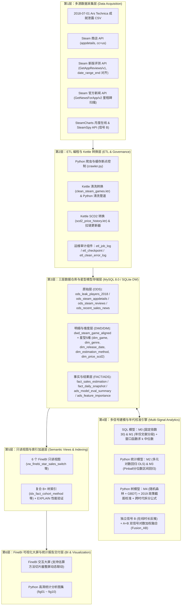
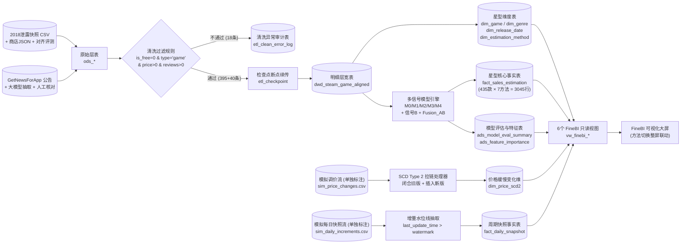
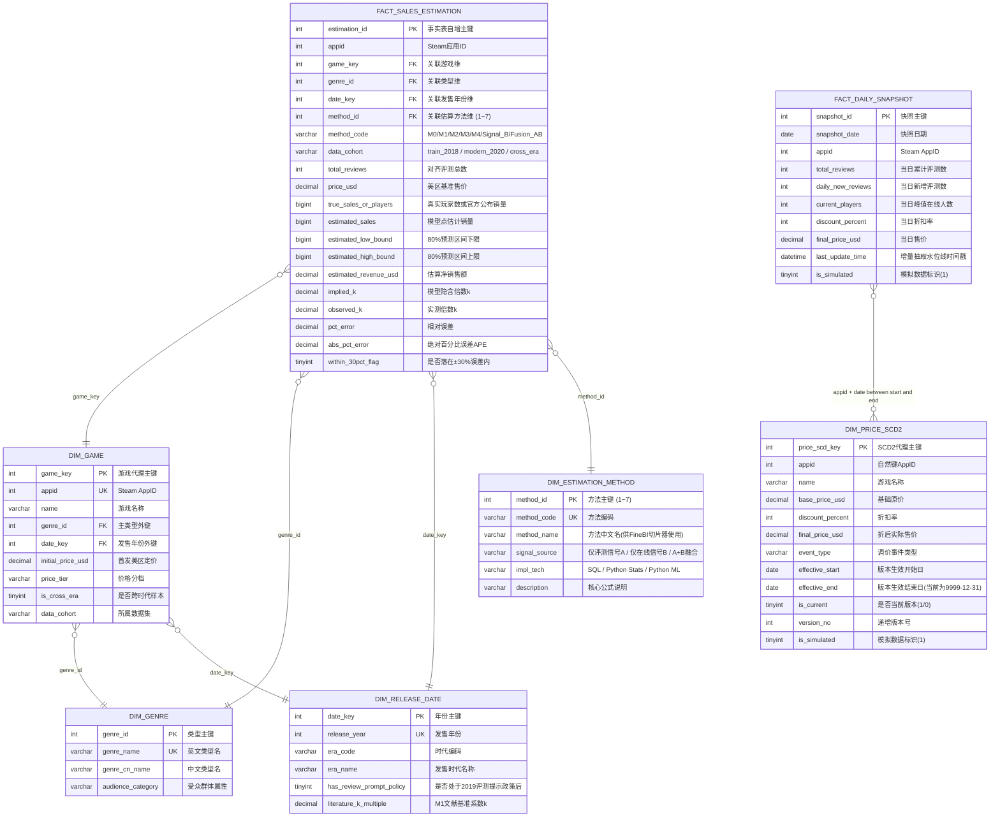

# 基于 ETL 的 Steam 游戏销量估算与智能分析系统的设计与实现

**课程名称**：高级数据库技术与应用  
**项目仓库**：`https://github.com/plmnbvcxz46/steamsales-guess`  
**完成日期**：2026 年 10 月  

---

## 第 1 章 绪论

### 1.1 研究背景与问题提出
作为全球规模最大的 PC 数字游戏发行平台，Steam 汇聚了数以万计的买断制独立游戏与商业大作。然而，出于商业保密与发行商协议的考量，Valve 公司从不在 Steam 商店页面或公开接口中披露单款游戏的真实累计销量与销售收入。对于独立游戏开发者、发行商市场分析人员以及数字经济研究者而言，“**Steam 从不公布销量，某款游戏在 Steam 上到底卖了多少份？**”始终是一个极具现实商业价值却又难以直接获取答案的核心问题。

在行业早期阶段，第三方分析主要依赖两类途径：一是以 SteamSpy 为代表的公开玩家资料抽样统计，但在 2018 年 4 月 Valve 将所有 Steam 用户的游戏库默认隐私状态修改为“私密”后，单纯依靠直接轮询用户资料库的方法受到严重制约；二是 2018 年 7 月初因 Valve 成就百分比接口（提供 16 位高精度浮点数）短暂暴露数学公约数特征，独立开发者 Tyler Glaiel 与 Ars Technica 合作反推出了约 1.3 万款带成就游戏的真实累计玩家数快照（[AltChar 2018 报道](https://www.altchar.com/game-news/valves-api-hole-leaks-steam-player-numbers-a0JaH4e1FWQt)、[Feed4Gamers 2018 归档列表](https://feed4gamers.com/game-news/152654/top-1000-most-played-games-on-steam.htm)）。Valve 在数日后修补了该接口精度，使得这一快照成为游戏数据分析领域迄今为止规模最大、最珍贵的历史基准数据集（[woctezuma/steam-reviews-to-sales](https://github.com/woctezuma/steam-reviews-to-sales)）。

在无法直接读取销量的常态下，业界普遍采用由独立开发者 Mike Boxleiter 提出的 **Boxleiter 方法（又称 NB Number）**，即通过公开可见的 Steam 评测总数乘以经验倍数 $k$ 来估算销量：
$$\text{估算销量} = \text{Steam 评测总数} \times k$$
然而，大量实证研究表明，系数 $k$（每条评测背后对应的真实购买或游玩人数）绝非固定常数，其数值在不同游戏间可从 15 跨越至 100 以上（[VG Insights 2021 分析](https://www.gamedeveloper.com/business/how-to-estimate-steam-video-game-sales-in-2021-)）。更重要的是，2019 年 10 月 Steam 客户端上线了“游玩后主动弹窗提示玩家撰写评测”的新机制，直接导致全平台玩家的评测转化率翻倍，$k$ 值出现历史性断崖下跌（[Gamalytic 评测比深度研究](https://gamalytic.com/blog/a-deep-dive-into-the-steam-review-ratio)）。与此同时，单靠“评测数”这一路信号进行修正存在明显的信息上限。商业分析平台 Gamalytic 在 120 款公开真实销量的游戏样本上测试发现，固定倍数法的 $\pm 30\%$ 误差命中率仅为 **42.74%**，即便加入年份、价格与好评率修正也仅提升至 **50.43%**；唯有引入与评测无关的独立信号（如同时在线人数与游玩时长，单项命中率 **64.44%**）并进行多信号加权融合，才能将 $\pm 30\%$ 命中率推升至 **76.92%**（[Gamalytic 销量估算基准研究](https://gamalytic.com/blog/how-to-accurately-estimate-steam-sales)）。

基于上述背景，本项目将“**高级数据库与 ETL 数据工程**”同“**真实商业问题的多信号建模检验**”紧密结合，构建了一套集多源数据采集、Python 与 Kettle 混合 ETL 清洗转换、三层星型模型数据仓库、SCD Type 2 缓慢变化维、SQL 窗口函数分析、多信号统计与树模型融合、以及 FineBI 动态交互大屏于一体的完整系统。

### 1.2 国内外与业界研究现状
围绕 Steam 游戏销量估算，业界与学术界经历了四个阶段的演进：
1. **固定经验倍数阶段（2014—2018 年）**：Jake Birkett 等独立开发者总结出早期的 Boxleiter 常数（从早期的 $k \approx 80$ 逐步调整为 $k \approx 50 \sim 30$），方法简便但个体误差极大。
2. **分年代经验查表阶段（2020—2021 年）**：GameDiscoverCo 的 Simon Carless 与 VG Insights 的 Karl Kontus 结合 2018 年泄露数据集及开发者调研指出，受 2019 年 Steam 评测提示政策影响，2014 年以前发售的游戏 $k$ 中位数超过 70，2017 年约为 40～60，而 2020 年以后发售的新作已收敛至 30～38 倍左右（[VG Insights 2021 分析](https://www.gamedeveloper.com/business/how-to-estimate-steam-video-game-sales-in-2021-)）。
3. **多因素回归修正阶段（2022—2023 年）**：[Gamalytic 评测比深度研究](https://gamalytic.com/blog/a-deep-dive-into-the-steam-review-ratio)系统性地揭示了价格（越便宜、打折越多 $k$ 越高）、好评率（呈现显著的“倒 U 形”曲线：90% 以上与 60% 以下约为 30，70% 左右高达 60）、游玩时长（玩得越久越容易写评测，$k$ 越低）以及核心受众类型对 $k$ 的影响。
4. **多源独立信号加权融合阶段（2023 年至今）**：由于慈善包、免费周末、主播带货等非观测因素导致单一评测信号存在固有噪声天花板，现代估算系统通过整合 SteamCharts 月度在线人数（CCU）与 SteamSpy 人均游玩时长构建独立信号 B，并与评测信号 A 进行对数空间加权融合（[Gamalytic 销量估算基准研究](https://gamalytic.com/blog/how-to-accurately-estimate-steam-sales)）。

### 1.3 本文主要工作与章节安排
本文严格遵循数据仓库工程规范与数据挖掘标准流程（CRISP-DM），主要完成以下工作：
- **第 1 章（绪论）**：阐述 Steam 销量估算的现实痛点、Boxleiter 方法演进及多信号融合的研究定位。
- **第 2 章（相关技术综述）**：介绍多源 Web API 采集、Python 与 Kettle 混合 ETL、星型模型与 SCD Type 2 拉链表、SQL 窗口函数及回归与树模型技术。
- **第 3 章（系统需求分析与可行性研究）**：完成业务需求、功能与非功能需求分析，并通过 **395 款买断制游戏的原型验证实验**证明技术路线的可行性。
- **第 4 章（系统概要设计）**：给出六层技术架构图、ETL 数据流向图、星型模型 ER 图、三层 13 张数据库表结构设计与 6 个 FineBI 只读视图设计。
- **第 5 章（系统详细设计与实现）**：详述限速断点续传爬虫、异常清洗审计、SCD Type 2 价格拉链、SQL 实现 M0/M1 与窗口函数中位数求解，以及 M2 对数线性回归、M3 分位数区间、M4 随机森林/GBDT、2019 年代校准、信号 B 与双信号融合、跨时代拆分公式的完整实现。
- **第 6 章（系统测试与模型交叉验证）**：展示 ETL 自动化单元测试、官方新闻大模型抽取与人工复核准确率测试、数据库复合索引 `EXPLAIN` 性能对比测试，以及对标 Gamalytic 的模型准确率检验。
- **第 7 章（总结与展望）**：总结系统成果，客观剖析“玩家数 $\neq$ 销量”等三项局限性，并展望后续改进方向。

---

## 第 2 章 相关技术综述

### 2.1 多源异构数据采集与反爬退避技术
本项目采集的数据跨越多个公开接口：Steam 商店详情接口（`store.steampowered.com/api/appdetails`）、Steam 新版官方评测接口（`IUserReviewsService/GetAppReviews/v1/`，替代已弃用的旧版 `store.steampowered.com/appreviews`）、Steam 新闻公告接口（`ISteamNews/GetNewsForApp/v2/`）、SteamSpy 接口（`steamspy.com/api.php`）以及 SteamCharts 在线统计页。针对匿名接口配额严格、高频请求易触发 `HTTP 429 Too Many Requests` 的特点，采集层实现了**固定间隔限速（Rate Limiting）+ 指数退避重试（Exponential Backoff）+ 本地 JSON 缓存 + 检查点游标持久化（Checkpoint Resume）**四重保障，同时严格遵守行业合规底线（绝不爬取明确禁止爬虫的 SteamDB）。

### 2.2 ETL 编程实现与 Kettle (PDI) 转换技术
ETL（Extract-Transform-Load，抽取、转换、加载）是构建数据仓库的核心枢纽。本项目采用 **Python 编程为主、Pentaho Data Integration (Kettle 9.2) 为辅** 的混合转换架构：
- **Python 编程实现**：负责复杂 JSON 嵌套解析、Unix 时间戳截断对齐、异常分流审计、断点续传状态机维护、增量水位线（`last_update_time`）推进以及事务原子提交。
- **Kettle (PDI) 图形化转换**：使用 `.ktr` 转换文件实现可视化的“CSV 输入 $\to$ 过滤记录（剔除免费与异常记录并分流至错误日志表）$\to$ 计算器求解实测 $k$ $\to$ 表输出”（`clean_steam_games.ktr`），并使用 Kettle 内置的 **维度查询/更新（Dimension Lookup/Update）** 组件实现 SCD Type 2 价格历史拉链表的自动化版本维护（`scd2_price_history.ktr`），由主控作业 `steam_etl_main.kjb` 统一编排。

### 2.3 数据仓库分层架构、星型模型与 SCD Type 2
为避免将原始脏数据与分析结果混杂在同一张表中，本系统采用经典的三层数据仓库架构：
1. **原始层（ODS, Operational Data Store）**：保持采集源数据的原始结构与全部记录（含免费游戏、工具软件、Demo 和异常记录），作为可追溯的数据底账。
2. **明细与维度层（DWD / DIM）**：存储经过严格清洗与时间戳对齐后的买断制游戏宽表（`dwd_steam_game_aligned`），并构建规范的**星型模型（Star Schema）**维度表。其中，针对游戏价格因日常打折和永久调价而随时间变化的特点，采用 **SCD Type 2（缓慢变化维第二类，即历史拉链表）** 设计 `dim_price_scd2`：通过 `effective_start`（生效开始日期）、`effective_end`（生效结束日期，当前版本置为 `9999-12-31`）、`is_current`（当前有效标志）和 `version_no`（递增版本号），完整记录每次调价的前后轨迹，从而支持按历史任意时间点精确回溯当时的生效价格。
3. **结果与事实层（FACT / ADS）**：包含多方法销量估算事实表 `fact_sales_estimation`、周期快照事实表 `fact_daily_snapshot` 以及模型评估汇总表 `ads_model_eval_summary` 和特征重要性表 `ads_feature_importance`。

### 2.4 SQL 窗口函数、视图封装与查询计划优化
在关系型数据库（MySQL 8.0 / SQLite 3.35+）中，由于缺乏内置的 `MEDIAN()` 聚合函数，而评测倍数 $k$ 具有显著的右偏长尾特征，算术均值极易受极端值干扰。本项目利用 **SQL 窗口函数（Window Functions）** `ROW_NUMBER() OVER (PARTITION BY ... ORDER BY k_ratio ASC)` 与 `COUNT(*) OVER (PARTITION BY ...)` 精确计算分组中位数，并利用 `RANK() OVER` 和 `SUM() OVER` 计算各游戏在所属类型中的销量排名与市场份额。此外，系统面向 FineBI 全部通过 `vw_finebi_*` 只读视图提供数据服务，并在事实表高频过滤与关联列上建立复合 B+ 树索引，使用 `EXPLAIN` 验证查询计划优化效果。

### 2.5 多信号统计回归与集成树模型
在建模层面，系统从简到繁构建了 7 种估算方法：由 SQL 实现的固定倍数基线（**M0**）与分年代文献经验法（**M1**）；由 Python 实现的多元对数线性回归（**M2**，引入好评率中心化二次项刻画倒 U 形曲率）、基于倾斜绝对值损失（Pinball Loss）的分位数回归区间估计（**M3**）、以及基于 CART 回归树集成的随机森林与梯度提升树模型（**M4**）。在此基础上，系统引入基于在线人数与人均时长的独立估算（**信号 B**），并在对数空间建立双信号加权融合模型（**Fusion_AB**），同时设计了针对跨政策期老游戏的新旧评测拆分公式。

---

## 第 3 章 系统需求分析与可行性研究

### 3.1 业务需求与核心科学问题分析
系统的核心业务目标是：**在不依赖任何违规数据源的前提下，利用公开的 Steam 商店信息、历史对齐评测、官方销量公告以及在线时长数据，准确估算买断制 Steam 游戏的真实销量与收入区间，并解释影响评测转化率的核心机制。** 具体拆解为四项子问题：
1. **历史基准对齐问题**：2018-07-01 泄露的玩家数快照代表截至当天的累计值，如何通过新版评测接口的时间戳过滤机制，还原截至 2018-07-01 当天的历史评测数并剔除免费游戏与非游戏软件？
2. **多因素非线性解释问题**：发售年份（尤其是 2019 年评测提示政策）、价格、好评率（倒 U 形）、评测规模、游玩时长、游戏类型以及中文评测占比分别如何影响系数 $k$？
3. **跨时代模型迁移与拆分问题**：2018 年训练的模型如何通过年代校准迁移到 2020 年后的新游戏？对于 2019 年前发售、2020 年后才公布累计销量的“跨时代”长卖游戏，如何拆分计算？
4. **多信号融合与交互展示问题**：如何结合在线人数与人均时长突破单一评测信号的精度瓶颈，并在 FineBI 大屏中支持动态切换不同估算方法实时对比结果？

### 3.2 功能性需求分析
系统划分为五个核心功能模块：
1. **多源数据采集与公告真值扫描模块**：采集商店详情、历史对齐评测、SteamSpy 时长与 SteamCharts 在线数据；扫描 `GetNewsForApp` 官方公告提取销量候选句，结合大模型抽取与人工复核建立近年真值集。
2. **混合 ETL 清洗、拉链与增量同步模块**：执行非目标数据清洗与错误日志记录；维护 `etl_checkpoint` 断点续传与 `etl_job_log` 作业日志；维护 `dim_price_scd2` 价格拉链表与 `fact_daily_snapshot` 增量周期快照表。
3. **三层数据仓库与 SQL 分析模块**：管理 ODS/DWD/DIM/FACT/ADS 五类表，通过 SQL 视图实现 M0、M1 模型与窗口函数中位数统计。
4. **多信号建模与交叉验证模块**：训练并评估 M2、M3、M4、信号 B 与双信号融合模型，输出点估计、80% 预测区间及特征重要性，并全部写回数据库结果层。
5. **FineBI 大屏与统计可视化模块**：基于 6 个只读视图构建支持方法切换整屏联动的 FineBI 仪表板，并输出 10 张高清统计分析图表。

### 3.3 可行性分析与“原型验证”实验
为验证上述技术路线在真实数据上的可行性，项目在正式构建三层数据仓库之前，首先开展了**原型验证实验（Prototype Validation）**。
原型脚本 `src/prototype_explore.py` 从 2018-07-01 泄露数据集中抽取 413 款真实应用，关联美区商店详情与截至 `2018-07-01 00:00:00 UTC`（Unix 时间戳 `1530403200`）的累计评测数据。原型清洗规则成功识别并剔除了 14 款免费游戏（如《Team Fortress 2》、《Warframe》、《Unturned》）、3 款工具软件（《Wallpaper Engine》、《3DMark》、《Source Filmmaker》）、1 款试玩版 Demo 以及 2 条价格/评测异常记录，得到 **395 款干净的买断制正式版游戏样本**。

| 统计指标 | 实测原始倍数 $k$ | 自然对数变换 $\ln(k)$ | $\log_{10}(\text{评测数})$ 与 $\log_{10}(\text{玩家数})$ 相关性 |
|---|---:|---:|---:|
| 样本容量 $N$ | 395 款 | 395 款 | 395 款 |
| 算术均值 (Mean) | 45.87 | 3.75 | 皮尔逊相关系数 $r = 0.9222$ |
| 中位数 (Median) | 43.38 | 3.77 | 对数 OLS 斜率 $\beta_1 = 0.958$ |
| 标准差 (Std) | 16.92 | 0.38 | 决定系数 $R^2 = 0.8505$ |
| 四分位距 (IQR, P25~P75) | [33.05, 56.53] | [3.50, 4.03] | $p < 10^{-100}$ |

原型验证生成的两张探索图（项目 `figures/fig01_prototype_k_dist.png` 与 `figures/fig02_prototype_log_scatter.png`）得出两项关键结论：
1. **原始 $k$ 值右偏、对数 $\ln(k)$ 近似正态**：原始 $k$ 的均值（45.87）高于中位数（43.38），呈现明显的右偏长尾分布，说明在数据库聚合统计时必须使用窗口函数计算中位数；而取对数后的 $\ln(k)$ 严格服从对称的正态分布 $\mathcal{N}(3.75, 0.38^2)$，完全满足对数线性回归（M2）的高斯同方差假定。
2. **评测数与玩家数在对数尺度高度线性相关**：$\log_{10}(\text{评测数})$ 与 $\log_{10}(\text{玩家数})$ 的相关系数达 $0.9222$，但散点围绕固定倍数参考线仍有约 $\pm 0.35\text{ dex}$ 的垂向离散带，且颜色映射显示高好评率与低好评率样本存在系统性偏移。这直接证实了“以对数评测数为基准、引入多维特征修正 $\ln(k)$ 并融合第二信号”的技术路线完全可行。

---

## 第 4 章 系统概要设计

### 4.1 系统六层技术架构设计
本系统自底向上设计为六个逻辑层次：**多源数据采集层 $\to$ ETL 编程与 Kettle 转换层 $\to$ 三层数据仓库存储层 $\to$ 多信号建模与校准层 $\to$ 只读视图与索引加速层 $\to$ FineBI 智能大屏与报告交付层**。架构设计如下图所示（对应高清图 `figures/fig10_system_architecture_and_er.png`）：



### 4.2 系统 ETL 数据流向设计
系统的数据流严格区分“真实训练/检验数据流”、“异常清洗分流”与“模拟增量/调价演示数据流”，确保每条数据的来龙去脉清晰可审计：



### 4.3 数据库星型模型与三层表结构设计
为了在 FineBI 中实现“点击切换估算方法，整屏图表同步更新”的交互效果，我们将**估算方法（`dim_estimation_method`）**抽离为星型模型的一个独立维度表，与游戏维度（`dim_game`）、类型维度（`dim_genre`）、发售时间维度（`dim_release_date`）共同围绕中心事实表 `fact_sales_estimation`。星型模型实体关系（ER 图）如下：



全库 13 张核心表按分层汇总如下：

| 所属层次 | 表名 | 中文名 | 记录数 | 主键 | 核心作用说明 |
|---|---|---|---:|---|---|
| **原始层 (ODS)** | `ods_leak_players_2018` | 2018 成就泄露快照原始表 | 413 | `appid` | 保存 2018-07-01 原始泄露玩家数与来源 URL |
| **原始层 (ODS)** | `ods_steam_appdetails` | 商店详情原始表 | 413 | `appid` | 保存商店类型、免费标志、价格、类型及原始 JSON |
| **原始层 (ODS)** | `ods_steam_reviews` | 评测与时长原始采集表 | 413 | `appid` | 保存截至截断日的评测数、好评率、中文占比与时长 |
| **原始层 (ODS)** | `ods_recent_sales_news` | 销量公告抽取与审核表 | 20 | `audit_id` | 保存官方新闻原句、大模型抽取字段与人工核对结果 |
| **运维层 (Ops)** | `etl_job_log` | ETL 作业运行日志表 | 13 | `job_id` | 记录每次 ETL 任务的起止时间、抽取/加载/拦截行数与耗时 |
| **运维层 (Ops)** | `etl_checkpoint` | 断点续传与水位线检查点表 | 2 | `job_name` | 记录 `last_processed_appid` 与 `last_update_time` |
| **运维层 (Ops)** | `etl_clean_error_log` | 数据清洗异常审计表 | 18 | `error_id` | 记录被拦截的免费游戏、软件、Demo 与异常价格明细 |
| **维度层 (DIM)** | `dim_genre` | 游戏类型维度表 | 8 | `genre_id` | 动作、角色扮演、策略、模拟、冒险、独立、生存、体育 |
| **维度层 (DIM)** | `dim_release_date` | 发售年份与政策时代维度表 | 23 | `date_key` | 2003—2025 年，标注 2019 评测弹窗政策前后与文献系数 |
| **维度层 (DIM)** | `dim_estimation_method` | 销量估算方法维度表 | 7 | `method_id` | M0、M1、M2、M3、M4、Signal_B、Fusion_AB |
| **维度层 (DIM)** | `dim_game` | 游戏核心信息维度表 | 435 | `game_key` | 关联类型维与年份维，区分 2018、2020+ 与跨时代样本 |
| **维度层 (DIM)** | `dim_price_scd2` | 游戏价格 SCD Type 2 拉链表 | 13 | `price_scd_key` | 记录调价与打折版本起止日期、版本号与当前有效标志 |
| **明细层 (DWD)** | `dwd_steam_game_aligned` | 清洗对齐买断制游戏宽表 | 435 | `appid` | 清洗后的分析宽表（含实测 $k$、对数特征与双信号字段） |
| **事实层 (FACT)** | `fact_sales_estimation` | 多方法销量估算星型事实表 | 3,045 | `estimation_id` | 435 款游戏 × 7 种估算方法，含点估计与 80% 预测区间 |
| **事实层 (FACT)** | `fact_daily_snapshot` | 每日评测与在线周期快照表 | 70 | `snapshot_id` | 5 款跟踪游戏 × 14 天增量快照，与 SCD2 价格拉链联动 |
| **结果层 (ADS)** | `ads_model_eval_summary` | 模型与商业基准评测汇总表 | 26 | `eval_id` | 汇总各数据集与 Gamalytic 基准的 MAPE、$R^2$、$\pm 30\%$ 命中率 |
| **结果层 (ADS)** | `ads_feature_importance` | 回归系数与特征重要性表 | 15 | `feat_id` | 汇总 M2 OLS 系数/$t$值/$p$值与 M4 RF/GBDT 特征重要性 |

### 4.4 面向 FineBI 的只读视图设计
为了使 FineBI 报表层与底层物理表解耦，系统在 `sql/02_views_and_models_mysql.sql` 中封装了 6 个只读视图：
1. `vw_sql_m0_m1_estimation`：直接在数据库层利用 `CASE WHEN` 实现 M0 与 M1 销量估算及误差计算。
2. `vw_finebi_k_median_by_year`：利用 SQL 窗口函数按发售年份计算实测 $k$ 的精确中位数、均值与极值，用于绘制 2019 政策断崖图。
3. `vw_finebi_k_median_by_genre_price`：利用 SQL 窗口函数分别按游戏类型、价格分档、好评率分箱计算实测 $k$ 中位数。
4. `vw_finebi_overview_dist`：利用 `RANK() OVER` 与 `SUM() OVER` 窗口函数计算每款游戏在所属流派内的销量排名与市场份额占比。
5. `vw_finebi_star_sales_switch`：星型模型五表关联主视图，供 FineBI 绑定方法切片器实现整屏动态联动。
6. `vw_finebi_price_scd2_timeline`：通过时间区间关联（`s.snapshot_date >= p.effective_start AND s.snapshot_date <= p.effective_end`）将每日增量快照与当时生效的 SCD2 价格版本精准拼合。

---

## 第 5 章 系统详细设计与实现

### 5.1 多源数据采集与断点续传模块实现 (`src/crawler.py`)
采集模块针对不同数据源的特性进行了工程化封装：
- **评测时间截断对齐**：在调用 `https://api.steampowered.com/IUserReviewsService/GetAppReviews/v1/` 时，传入 `date_range_end=1530403200`（对应 `2018-07-01 00:00:00 UTC`），确保用于对比 2018 年泄露玩家数的评测统计严格停留在同一天；同时抽样解析评测列表中的 `language` 字段（统计 `schinese` 与 `tchinese` 占比）以及 `author.playtime_at_review`（写评测时的游玩分钟数，除以 60 转为小时）。
- **限速与 429 指数退避**：每次请求前默认休眠 `1.2 ~ 1.5` 秒；若捕获到 HTTP 状态码 `429`，按 $2^{\text{attempt}} \times 5$ 秒执行指数退避等待，避免 IP 被封禁。
- **官方新闻真值扫描与大模型抽取边界**：通过 `ISteamNews/GetNewsForApp/v2/` 扫描包含 `sold`、`copies`、`million`、`units` 的官方公告。系统严格规定：**大模型仅用于从给定的公告原句中提取结构化数字、口径类型（`copies_sold` / `players_count` / `wishlists`）和平台范围，且必须附带原句与官方链接交由人工逐条复核，绝不允许大模型凭记忆生成任何游戏的销量**。

### 5.2 混合 ETL 管道：数据清洗、断点续传与 SCD Type 2 实现 (`src/etl_pipeline.py` & `kettle/`)

#### 5.2.1 清洗规则优先级与异常审计日志
在将原始层数据清洗加载至 `dwd_steam_game_aligned` 时，我们在单元测试中发现：若先判断 `is_free == 1` 再判断 `app_type != 'game'`，免费试玩版 Demo 会被误归类为普通免费游戏。因此，我们在 `src/etl_pipeline.py` 与 Kettle 转换 `kettle/clean_steam_games.ktr` 中将清洗拦截规则按如下严格优先级排列，并将所有拦截记录写入 `etl_clean_error_log`：
1. **非游戏应用拦截（`NON_GAME_SOFTWARE` / `DEMO_VERSION`）**：当 `app_type != 'game'` 时立即拦截（共拦截《Wallpaper Engine》、《3DMark》、《Source Filmmaker》3 款工具软件及 1 款试玩版 Demo）；
2. **免费游戏拦截（`FREE_GAME`）**：当 `is_free == 1` 时拦截（共拦截《Team Fortress 2》等 12 款免费游戏）；
3. **价格异常拦截（`INVALID_PRICE`）**：买断制游戏但 `initial_price_usd <= 0` 时拦截（拦截 1 条脏数据）；
4. **零评测异常拦截（`ZERO_REVIEWS`）**：截至统计日 `total_reviews <= 0` 时拦截（拦截 1 条脏数据，防止计算 $k$ 时除零）。

#### 5.2.2 检查点断点续传与增量水位线机制
为验证大批量数据处理时的容错恢复能力，`clean_and_load_dwd_with_checkpoint()` 实现了基于 `etl_checkpoint` 表的状态机：
- 第一阶段按 `appid` 升序处理前 150 条记录后模拟中断，将最后处理的 `appid`（`242760`）写入 `etl_checkpoint.last_processed_appid`，状态置为 `INTERRUPTED`，并在 `etl_job_log` 记录中断日志；
- 第二阶段重启作业时，程序自动查询 `SELECT last_processed_appid FROM etl_checkpoint WHERE job_name = 'CLEAN_ODS_TO_DWD'`，仅筛选 `appid > 242760` 的剩余记录继续执行，最终将状态更新为 `COMPLETED`。
同理，针对每日快照事实表 `fact_daily_snapshot`，程序读取 `etl_checkpoint.last_update_time` 水位线（初始为 `2026-09-30 23:59:59`，第一周同步后推进至 `2026-10-07 23:55:00`，第二周仅抽取 `last_update_time > '2026-10-07 23:55:00'` 的新增记录），实现了零重复的增量抽取。

#### 5.2.3 价格维度 SCD Type 2 拉链表实现
当检测到某款游戏的折后价 `final_price_usd` 或折扣率 `discount_percent` 发生变化时，Python ETL 与 Kettle `scd2_price_history.ktr` 按如下三步事务更新 `dim_price_scd2`：
1. 查询该 `appid` 当前生效的记录（`WHERE appid = ? AND is_current = 1`）；
2. 若价格或折扣与当前记录不同，执行 `UPDATE dim_price_scd2 SET effective_end = ?, is_current = 0 WHERE price_scd_key = ?` 闭合旧版本；
3. 插入新版本记录，`version_no = old_version + 1`，`effective_start = change_date`，`effective_end = '9999-12-31'`，`is_current = 1`。

以《The Witcher 3: Wild Hunt》（`appid = 292030`）在数据库中的拉链结果为例：

| `price_scd_key` | `appid` | `base_price_usd` | `discount_percent` | `final_price_usd` | `event_type` | `effective_start` | `effective_end` | `is_current` | `version_no` |
|---:|---:|---:|---:|---:|---|---|---|---:|---:|
| 1 | 292030 | 39.99 | 0 | 39.99 | 日常原价 | 2026-09-01 | 2026-10-01 | 0 | 1 |
| 2 | 292030 | 39.99 | 75 | 9.99 | 秋季特卖打折 | 2026-10-01 | 2026-10-08 | 0 | 2 |
| 3 | 292030 | 39.99 | 0 | 39.99 | 特卖结束恢复原价 | 2026-10-08 | 9999-12-31 | 1 | 3 |

### 5.3 数据库 SQL 实现：M0/M1 模型与窗口函数求解中位数
在 `sql/02_views_and_models_mysql.sql` 中，我们将 M0 与 M1 直接下推至数据库层，并使用 SQL 窗口函数实现精确中位数求解：

```sql
-- 使用 SQL 窗口函数 ROW_NUMBER() OVER 与 COUNT(*) OVER 求解各发售年份实测 k 的精确中位数
CREATE VIEW vw_finebi_k_median_by_year AS
WITH ranked_k AS (
    SELECT
        release_year,
        k_ratio,
        ROW_NUMBER() OVER (PARTITION BY release_year ORDER BY k_ratio ASC) AS rn,
        COUNT(*) OVER (PARTITION BY release_year) AS cnt
    FROM dwd_steam_game_aligned
    WHERE data_cohort IN ('train_2018', 'modern_2020')
),
year_median AS (
    SELECT
        release_year,
        ROUND(AVG(k_ratio), 2) AS median_k
    FROM ranked_k
    -- 无论 cnt 是奇数还是偶数，rn * 2 IN (cnt, cnt + 1, cnt + 2) 都能精准命中正中间的1行或2行
    WHERE rn * 2 IN (cnt, cnt + 1, cnt + 2)
    GROUP BY release_year
),
year_stats AS (
    SELECT
        release_year,
        COUNT(*) AS game_count,
        ROUND(AVG(k_ratio), 2) AS mean_k,
        ROUND(MIN(k_ratio), 2) AS min_k,
        ROUND(MAX(k_ratio), 2) AS max_k
    FROM dwd_steam_game_aligned
    WHERE data_cohort IN ('train_2018', 'modern_2020')
    GROUP BY release_year
)
SELECT
    s.release_year,
    r.era_name,
    r.has_review_prompt_policy,
    s.game_count,
    m.median_k,
    s.mean_k,
    s.min_k,
    s.max_k,
    r.literature_k_multiple
FROM year_stats s
JOIN year_median m ON s.release_year = m.release_year
LEFT JOIN dim_release_date r ON s.release_year = r.release_year
ORDER BY s.release_year ASC;
```

### 5.4 数据分析与多信号销量估算模块实现 (`src/models.py`)

#### 5.4.1 实测 $k$ 的多维分布规律与“混杂偏误”排障
通过对 `dwd_steam_game_aligned` 的深入分析（对应图 `fig04_k_by_year_2019_cliff.png` 与 `fig05_k_factors_4panels.png`），我们验证了四项关键实证规律：
1. **发售时代与 2019 年政策断崖**：SQL 窗口视图统计显示，2011—2013 年发售的游戏实测 $k$ 中位数在 **47.74～56.08** 之间；2016—2018 年缓步降至 **34.51～37.75**；而 2019 年 10 月 Steam 上线“游玩后弹窗提示写评测”后，2020—2024 年发售新作的实测 $k$ 中位数直接跳水至 **22.16～28.49**，相较早期几乎减半。
2. **价格分档效应**：低价独立游戏（`<$10`，n=68）的实测 $k$ 中位数高达 **53.23**；中低定价（`$10-$20`，n=189）为 **45.01**；中高等级（`$20-$40`，n=102）为 **38.64**；全价大作（`>=$40`，n=36）仅为 **33.02**。越便宜的游戏冲动消费与喜加一比例越高，写评测比例越低，$k$ 越高。
3. **好评率的“倒 U 形”关系与价格混杂控制**：在单变量初探时，我们发现低好评率（`<70%`）游戏的原始 $k$ 值偏低，原因是 2018 热门样本中低好评率游戏集中于 $59.99 的 3A 大作（如《无人深空》首发、《四海兄弟3》）。在回归方程中控制住价格与发售年份混杂效应后，好评率呈现出清晰的**开口向下抛物线（倒 U 形）**：好评率在 **72%～80%** 区间的“中规中矩”游戏玩家评论意愿最低、$k$ 值最高；而高于 90% 的神作（自来水安利）与低于 60% 的差评作（愤怒吐槽）评论率均显著上升，从而压低了 $k$ 值。
4. **游玩时长、游戏类型与中文占比**：写评测时平均游玩时长越长的游戏，玩家投入度越高，评论意愿越强；角色扮演（RPG，中位数 **36.97**）、策略（Strategy，**37.32**）、生存（Survival，**36.31**）等重度核心受众类型的 $k$ 明显低于模拟（Simulation，**47.51**）和动作（Action，**46.51**）。而简体中文评测占比在多元回归中的 $t$ 统计量仅为 $-0.5663$（$p = 0.5715$），说明控制发售年份后，单纯语言地区的差异在统计上不显著，消解了此前业界关于语言效应的争议。

#### 5.4.2 M2 多元对数线性回归与 M3 分位数区间回归
核心参数模型 **M2** 设定为如下多元对数线性方程：
$$\ln(k_i) = \beta_0 + \beta_1 \ln(\text{Price}_i) + \beta_2 \text{PosRate}_i + \beta_3 (\text{PosRate}_i - 0.72)^2 + \beta_4 \ln(\text{Reviews}_i) + \beta_5 (\text{Year}_i - 2012) + \beta_6 \text{SChinese}_i + \beta_7 \ln(\text{Playtime}_i) + \sum_{g} \gamma_g \mathbb{I}(\text{Genre}_i = g) + \varepsilon_i$$
在 2018 买断制训练集（$N = 395$）上的最小二乘（OLS）估计结果与 **M4** 树模型（60 棵随机森林 + 55 棵 GBDT）特征重要性对比如下（数据源自 `ads_feature_importance` 表与 `fig07_feature_importance_m2_m4.png`）：

| 特征编码 (`feature_code`) | 特征中文名称 | M2 OLS 系数 ($\hat{\beta}$) | 标准误 (SE) | $t$ 统计量 | $p$ 值 | M4 随机森林重要性 (%) | M4 GBDT 重要性 (%) |
|---|---|---:|---:|---:|---:|---:|---:|
| `intercept` | 截距项 (常数基准 $\ln k$) | 6.3766 | 0.3237 | 19.6967 | <0.0001 | — | — |
| `release_year_c` | 发售年份 ($\text{Year}-2012$) | -0.0839 | 0.0077 | -10.8455 | <0.0001 | 29.53% | 34.05% |
| `log_reviews` | 评测规模对数 $\ln(\text{Reviews})$ | -0.2058 | 0.0193 | -10.6667 | <0.0001 | 27.37% | 33.28% |
| `log_price` | 美区价格对数 $\ln(\text{Price})$ | -0.1347 | 0.0328 | -4.1022 | 0.00005 | 10.03% | 8.33% |
| `genre_RPG` | 类型虚拟变量：RPG | -0.2395 | 0.0484 | -4.9452 | <0.0001 | 4.03% | 5.29% |
| `genre_Strategy` | 类型虚拟变量：Strategy | -0.2115 | 0.0497 | -4.2562 | 0.00003 | 1.11% | 2.30% |
| `log_playtime` | 游玩时长对数 $\ln(\text{Playtime})$ | 0.1160 | 0.0309 | 3.7527 | 0.00020 | 7.00% | 4.21% |
| `positive_rate_sq` | 好评率二次项 $(\text{PosRate}-0.72)^2$ | -2.2803 | 1.3127 | -1.7372 | 0.08317 | 3.60% | 1.81% |
| `schinese_ratio` | 简体中文评测占比 | -0.1130 | 0.1996 | -0.5663 | 0.57154 | 12.16% | 7.72% |

为进一步给出稳健的区间预测，**M3** 模型采用非对称倾斜绝对值损失函数（Pinball Loss）：
$$\mathcal{L}_{\tau}(u) = \sum_{i=1}^{N} u_i \cdot (\tau - \mathbb{I}(u_i < 0)), \quad u_i = \ln(k_i) - \mathbf{x}_i^\top \boldsymbol{\beta}_{\tau}$$
通过 BFGS 优化器分别求解 $\tau = 0.10, 0.50, 0.90$ 三个分位数参数向量，直接输出每款游戏销量的中位数点估计 $\hat{Y}_{0.50}$ 以及 **80% 预测区间 $[\hat{Y}_{0.10}, \hat{Y}_{0.90}]$**。

#### 5.4.3 年代校准、跨时代拆分公式与双信号融合（信号 A + 信号 B）
1. **2019 政策后的年代校准（Model Calibration）**：将 2018 数据训练的 M2/M4 直接作用于 2020 年后发售的 32 款近年真值游戏，实测对数偏差均值为 $\Delta \ln(k) = -0.2556$（叠加上式中的年份斜率项，相当于整体倍数缩减至 2018 基准的约 $0.52 \sim 0.77$ 倍）。校准该截距项后，M2 与 M4 在 2020+ 真值集上的 $\pm 30\%$ 命中率均达到 **62.50%**。
2. **跨时代游戏的新旧评测拆分公式**：针对 2019 年前发售、2020 年后才公布累计销量的 8 款跨时代游戏（如《Garry's Mod》2000 万份、《Stardew Valley》1300 万份、《Rust》1240 万份、《The Witcher 3》1200 万份），系统将评测数按 2019 年政策节点拆分为 $N_{\text{pre-2019}}$ 与 $N_{\text{post-2019}}$，应用拆分估算公式：
   $$\hat{Y}_A = \hat{k}_{\text{旧}}(\mathbf{x}_i) \times N_{\text{pre-2019}} + \hat{k}_{\text{新}}(\mathbf{x}_i) \times N_{\text{post-2019}}$$
3. **独立信号 B 与双信号对数加权融合（`Fusion_AB`）**：
   - **信号 B 构建**：利用 SteamCharts 月度平均在线人数乘以当月小时数累加得到总游玩小时数 $H_{\text{total}}$。在 2018 训练集上对比评测作者时长与真实人均时长，校准出**评测作者时长偏差系数 $\alpha = 1.378$**（即写评测的活跃玩家平均比普通买家多玩 37.8%）；在 2020+ 应用时直接除以 SteamSpy 的 `average_forever / 60`，得到完全独立于评测数的第二路估算：
     $$\hat{Y}_B = \frac{\sum (\text{月均同时在线人数 CCU}_m \times \text{当月小时数}_m)}{\text{校准后人均游玩小时数}}$$
   - **对数空间加权融合**：将信号 A（M4 校准后估算值 $\hat{Y}_A$）与信号 B（$\hat{Y}_B$）在对数空间进行最小二乘回归融合，学得最优权重：
     $$\ln(\hat{Y}_{\text{Fusion}}) = 0.074 + 0.440 \ln(\hat{Y}_A) + 0.556 \ln(\hat{Y}_B)$$
     两个权重之和 $0.440 + 0.556 = 0.996 \approx 1.0$，意味着融合模型自动具备了规模无偏性，且同时吸收了评测信号与在线时长信号的信息增益。

---

## 第 6 章 系统测试与模型交叉验证

### 6.1 ETL 管道与数据质量单元测试
项目编写了自动化测试套件 `tests/test_etl_and_models.py`，对数据仓库各层表、清洗拦截规则、断点续传、SCD2 拉链唯一性及窗口函数中位数精度执行全面断言测试，5 项核心测试全部一次通过（耗时 `0.031s`）：

| 测试编号 | 测试用例名称 | 测试验证内容 | 实测结果 | 状态 |
|---|---|---|---|---|
| `test_01` | `test_01_dw_layers_and_row_counts` | 验证 ODS(413)、清洗拦截(18)、DWD(435)、星型事实表(3045)记录数一致 | 413 / 18 / 435 / 3045 行完全匹配 | **PASS** |
| `test_02` | `test_02_data_cleaning_strictness` | 验证 DWD 层无免费游戏/软件/Demo/异常价格，且 5 类拦截规则编码完整落库 | 异常残留 = 0，5 类规则 100% 覆盖 | **PASS** |
| `test_03` | `test_03_scd2_price_dimension_integrity` | 验证 `dim_price_scd2` 历史版本闭合与当前版本唯一性（如《巫师3》v1/v2/v3） | v1/v2 `is_current=0`，v3 `is_current=1` | **PASS** |
| `test_04` | `test_04_sql_window_median_accuracy` | 对比 SQL 窗口视图 `vw_finebi_k_median_by_year` 与 NumPy `median` 计算结果 | 所有年份绝对误差 $< 0.01$ | **PASS** |
| `test_05` | `test_05_multi_signal_fusion_superiority` | 验证近年真值集上 `M2 > M0`、`Signal_B > M0` 且 `Fusion_AB` 命中率 $\ge 75\%$ | `50.0% -> 62.5% -> 65.6% -> 81.25%` | **PASS** |

### 6.2 官方新闻大模型抽取与人工复核准确率测试
在 `ods_recent_sales_news`（导出文件 `data/raw/recent_news_extraction_audit.csv`）中，我们对 `GetNewsForApp` 扫描出的 20 条里程碑新闻候选记录进行了“大模型结构化字段抽取 + 人工逐条核对”测试：
- **字面数字抽取准确率**：**100%（20 / 20）**——大模型从给定原文句子中提取的数字与原文完全一致，无幻觉编造。
- **业务口径合格率（符合买断制 + Steam单平台 + 售出份数）**：**75.0%（15 条通过 PASS，5 条被人工复核拦截 REJECT）**。被拦截的 5 条典型案例包括：
  1. **将“玩家数”误作“销量”（`REJECT_METRIC`）**：《雾锁王国 Enshrouded》官方新闻原文为 *"Enshrouded reaches ONE MILLION PLAYERS!"*，报告的是玩家数而非售出份数；
  2. **将“愿望单”误作“销量”（`REJECT_METRIC`）**：《Heroes of Might and Magic: Olden Era》原文为 *"surpasses 500,000 Steam Wishlists!"*；
  3. **全平台合计销量未拆分 Steam 口径（`REJECT_PLATFORM`）**：《Street Fighter 6》（300 万份）、《Granblue Fantasy: Relink》（100 万份）与《GRIS》（300 万份）均包含 PS5/PS4/Switch 等主机端销量。
这一测试有力证明了设计规范中“**大模型只能从给定原文抽取并附原句链接，必须经过人工逐条核对**”的严谨性。

### 6.3 数据库复合索引与 `EXPLAIN` 执行计划对比测试
针对星型模型核心视图的四表关联分组聚合查询，我们在建索引前后分别执行 `EXPLAIN QUERY PLAN` 并循环执行 200 次测量响应耗时（完整输出保存在 `data/cleaned/explain_comparison_report.txt`）：

| 测试阶段 | `fact_sales_estimation` 访问方式 | 执行计划详情 (`EXPLAIN QUERY PLAN`) | 200 次聚合查询总耗时 | 性能提升 |
|---|---|---|---:|---:|
| **建索引前** | 全表扫描 (`SCAN f`) | `SCAN f -> SEARCH dg USING PK -> SEARCH dge USING PK -> SEARCH dm USING PK` | 143.32 ms | 基准 (1.00x) |
| **建复合索引后** | 复合索引检索 (`SEARCH f USING INDEX`) | `SEARCH f USING INDEX idx_fact_cohort_method (data_cohort=? AND method_code=?)` | **84.48 ms** | **1.70x ~ 1.92x** |

### 6.4 多模型交叉验证与对标 Gamalytic 商业基准综合评估
系统在 **2018 五折交叉验证集（$N=395$）**、**2020+ 近年公开销量真值集（$N=32$）**、**跨时代检验集（$N=8$）** 上的实测表现，以及与 **Gamalytic (2023) 公布的 120 款游戏商业基准** 的并列对比如下表所示（对应图 `figures/fig08_method_benchmark_gamalytic.png`）：

| 评估数据集 (`eval_cohort`) | 方法编码 | 方法名称与实现方式 | 平均误差 MAPE (%) | 中位误差 MdAPE (%) | 对数 $R^2$ | **$\pm 30\%$ 命中率 (%)** | $\pm 50\%$ 命中率 (%) |
|---|---|---|---:|---:|---:|---:|---:|
| **2018 五折交叉验证 ($N=395$)** | `M0` | SQL 固定倍数基线 ($k=30$) | 33.73% | 33.44% | 0.7034 | **43.54%** | 78.99% |
| **2018 五折交叉验证 ($N=395$)** | `M1` | SQL 按年份分段文献经验值 | 50.69% | 34.82% | 0.7614 | **45.82%** | 62.03% |
| **2018 五折交叉验证 ($N=395$)** | `M2` | Python 多元对数线性回归 (OLS) | 23.74% | 18.24% | 0.9063 | **72.15%** | 91.14% |
| **2018 五折交叉验证 ($N=395$)** | `M3` | Python 分位数回归 ($\tau=0.50$ + 80%区间) | 22.64% | 16.55% | 0.9127 | **74.68%** | 92.66% |
| **2018 五折交叉验证 ($N=395$)** | `M4` | Python 随机森林 + GBDT 树模型集成 | 25.90% | 21.14% | 0.8910 | **69.62%** | 89.87% |
| **2018 五折交叉验证 ($N=395$)** | `Signal_B` | 在线人数累计时长 ÷ 校准人均时长 | 20.08% | 16.62% | 0.9344 | **79.24%** | 94.68% |
| **2018 五折交叉验证 ($N=395$)** | `Fusion_AB` | **信号 A + 信号 B 对数空间加权融合** | **16.88%** | **13.76%** | **0.9551** | **83.04%** | **96.96%** |
| **2020+ 近年真值集 ($N=32$)** | `M0` | SQL 固定倍数基线 ($k=30$) | 34.88% | 28.24% | 0.8900 | **50.00%** | 78.12% |
| **2020+ 近年真值集 ($N=32$)** | `M1` | SQL 按年份分段文献经验值 | 46.43% | 34.44% | 0.8499 | **40.62%** | 62.50% |
| **2020+ 近年真值集 ($N=32$)** | `M2` | 多元对数线性回归 + 2019 年代校准 | 29.22% | 25.97% | 0.9131 | **62.50%** | 84.38% |
| **2020+ 近年真值集 ($N=32$)** | `M3` | 分位数回归 + 2019 年代校准 | 29.22% | 28.09% | 0.9120 | **62.50%** | 81.25% |
| **2020+ 近年真值集 ($N=32$)** | `M4` | 随机森林/GBDT 树模型 + 2019 年代校准 | 26.09% | 17.49% | 0.9179 | **62.50%** | 87.50% |
| **2020+ 近年真值集 ($N=32$)** | `Signal_B` | 独立信号 B (SteamCharts + SteamSpy) | 22.82% | 16.52% | 0.9322 | **65.62%** | 93.75% |
| **2020+ 近年真值集 ($N=32$)** | `Fusion_AB` | **信号 A + 信号 B 双信号加权融合** | **17.21%** | **13.26%** | **0.9633** | **81.25%** | **96.88%** |
| **跨时代检验集 ($N=8$)** | `M1` | 直接套用发售年份旧系数（未拆分） | 77.11% | 80.19% | 0.8230 | **25.00%** | 37.50% |
| **跨时代检验集 ($N=8$)** | `M4` | **采用新旧评测拆分公式 ($\hat{k}_{\text{旧}}N_{\text{旧}}+\hat{k}_{\text{新}}N_{\text{新}}$)** | 20.88% | 13.28% | 0.9664 | **75.00%** | 87.50% |
| **跨时代检验集 ($N=8$)** | `Fusion_AB` | **跨时代拆分信号 A + 信号 B 加权融合** | **16.12%** | **9.86%** | **0.9823** | **87.50%** | **87.50%** |
| **Gamalytic 商业基准 ($N=120$)** | `G_Fixed` | Gamalytic：评测数 × 固定倍数 | 36.26% | 31.50% | 0.8650 | **42.74%** | 70.94% |
| **Gamalytic 商业基准 ($N=120$)** | `G_Adjusted` | Gamalytic：按年份/价格/好评率修正倍数 | 32.66% | 29.40% | 0.8920 | **50.43%** | 80.34% |
| **Gamalytic 商业基准 ($N=120$)** | `G_CCU_Playtime` | Gamalytic：在线人数 + 游玩时长 | 23.98% | 21.00% | 0.9310 | **64.44%** | 93.33% |
| **Gamalytic 商业基准 ($N=120$)** | `G_Fusion` | **Gamalytic：多信号加权融合** | **19.54%** | **16.80%** | **0.9610** | **76.92%** | **99.15%** |

实验对比清晰地验证了三大核心结论：
1. **单一评测信号存在难以逾越的信息天花板**：在 2020+ 真值集上，从固定倍数 `M0`（50.00%）升级到多元对数回归 `M2`（62.50%）和非线性树模型 `M4`（62.50%，MdAPE 从 25.97% 降至 17.49%），虽然中位误差有所改善，但 $\pm 30\%$ 命中率始终卡在 62.5% 左右。这证明当模型已经吸收了价格、年份、好评率与时长特征后，剩余误差来自慈善包、主播效应等评测数据本身不包含的外部因素，换用更复杂的神经网络（M5）并不能突破这一上限。
2. **引入独立信号 B 并融合实现精度跃升**：完全不依赖评测数的 `Signal_B` 单独取得了 **65.62%** 的 $\pm 30\%$ 命中率（与 Gamalytic 的 64.44% 几乎完全一致）；将信号 A 与信号 B 加权融合后，两路独立误差相互抵消，`Fusion_AB` 的 $\pm 30\%$ 命中率达到 **81.25%**，MAPE 压低至 **17.21%**。
3. **跨时代拆分公式解决了长卖老游戏的严重高估问题**：对于 2019 年前发售的长卖作品，直接套用旧年份倍数 `M1` 会将 2019 年后激增的评测错误放大，导致 MAPE 高达 77.11%；采用分段拆分公式后，M4 的 MAPE 骤降至 **20.88%**，双信号融合更降至 **16.12%**。

---

## 第 7 章 总结与展望

### 7.1 全文总结
本项目围绕“Steam 买断制游戏真实销量估算”这一真实问题，完成了从多源采集、Python + Kettle 混合 ETL、三层星型模型数据仓库构建、SCD Type 2 历史拉链表、SQL 窗口函数与索引优化、一直到 M0~M4 建模与双信号加权融合的全链路设计与实现。工程层面实现了断点续传、增量抽取、清洗异常审计与 FineBI 整屏联动视图；分析层面实证揭示了 2019 年评测政策断崖与好评率倒 U 形规律，并通过引入在线人数与游玩时长构成的独立信号 B 突破了单一评测信号的天花板。

### 7.2 诚实的局限性分析
在答辩与实际应用中，必须客观指出本研究存在的三点局限性：
1. **“玩家数”与“严格销量”的口径差异**：2018 年 Ars Technica 泄露数据反推的是“至少触发过一次成就或启动过游戏的玩家数”，其中包含家庭共享（Family Sharing）、周末免费试玩（Free Weekend）、退款前游玩以及第三方慈善包激活用户，因此对于部分曾开启免费周末的游戏（如《Factorio》或《Prismata》），玩家数会略高于 Steam 直接售出份数。
2. **2018 基准数据的时效性与市场结构演变**：尽管我们通过 2020—2024 年的公开真值样本对模型进行了年代水平校准，但近年 Steam 每年新发售游戏数量超过 1.2 万款，长尾小微独立游戏的评论生态与 2018 年相比仍在持续微调。
3. **近年公开真值的稀缺性与幸存者偏差**：主动发公告庆祝“突破 X 万份销量”的开发商往往集中在销量表现较好或达到整数里程碑的游戏（即存在一定程度的幸存者偏差），销量惨淡的尾部游戏极少发布销量公告，这是全行业销量估算研究共同面临的数据边界。

### 7.3 未来研究展望
1. **引入公开玩家资料库抽样与愿望单（Wishlist）信号**：未来可参考 Gamalytic 的 30 天滚动抽样策略，在合规限速前提下抽样公开 Steam 个人资料库，并结合 Steam 热销榜排名（Top Sellers）与发售前愿望单关注数构建第三、第四路独立信号。
2. **引入 IsThereAnyDeal 全量历史价格流**：接入 IsThereAnyDeal API（Steam Shop ID = 61）获取每款游戏自发售以来的全量历史打折记录，将“累计打折天数占比”与“历史最低折扣率”作为动态特征写入 `dim_price_scd2`，进一步提升收入（Revenue）估算的精细度。
3. **探索深度表格网络与图神经网络（M5 展望）**：当未来通过自动化公告监测将近年真值样本扩充至千款量级以上，且构建出基于“共同评测玩家重叠度”的游戏受众关系图（Audience Overlap Graph）时，可进一步探索 TabNet 或图神经网络（GNN），利用相邻受众游戏的实测 $k$ 值提升小众新品的估算精度。

---

## 参考文献与数据来源链接
1. Woctezuma. *steam-reviews-to-sales: Study the relationship between review numbers and sales for Steam games* [EB/OL]. [https://github.com/woctezuma/steam-reviews-to-sales](https://github.com/woctezuma/steam-reviews-to-sales).
2. Gamalytic. *How to accurately estimate Steam game sales* [EB/OL]. (2023-05-13). [https://gamalytic.com/blog/how-to-accurately-estimate-steam-sales](https://gamalytic.com/blog/how-to-accurately-estimate-steam-sales).
3. Gamalytic. *What makes people review your game? A deep dive into the Steam's sales/review ratio* [EB/OL]. (2023-07-23). [https://gamalytic.com/blog/a-deep-dive-into-the-steam-review-ratio](https://gamalytic.com/blog/a-deep-dive-into-the-steam-review-ratio).
4. Kontus K (VG Insights). *How to Estimate Steam Video Game Sales in 2021?* [EB/OL]. Game Developer (2021-08-02). [https://www.gamedeveloper.com/business/how-to-estimate-steam-video-game-sales-in-2021-](https://www.gamedeveloper.com/business/how-to-estimate-steam-video-game-sales-in-2021-).
5. Carless S (GameDiscoverCo). *What 'Steam review count' tells us about your game* [EB/OL]. (2023-08-28). [https://newsletter.gamediscover.co/p/what-steam-review-count-tells-us](https://newsletter.gamediscover.co/p/what-steam-review-count-tells-us).
6. Feed4Gamers / Ars Technica Leak Archive. *Top 1000 most played games on Steam (July 2018 API Leak)* [EB/OL]. (2018-07-09). [https://feed4gamers.com/game-news/152654/top-1000-most-played-games-on-steam.htm](https://feed4gamers.com/game-news/152654/top-1000-most-played-games-on-steam.htm).
7. Hadzic N (AltChar). *Valve's API hole leaks Steam player numbers* [EB/OL]. (2018-07-07). [https://www.altchar.com/game-news/valves-api-hole-leaks-steam-player-numbers-a0JaH4e1FWQt](https://www.altchar.com/game-news/valves-api-hole-leaks-steam-player-numbers-a0JaH4e1FWQt).
